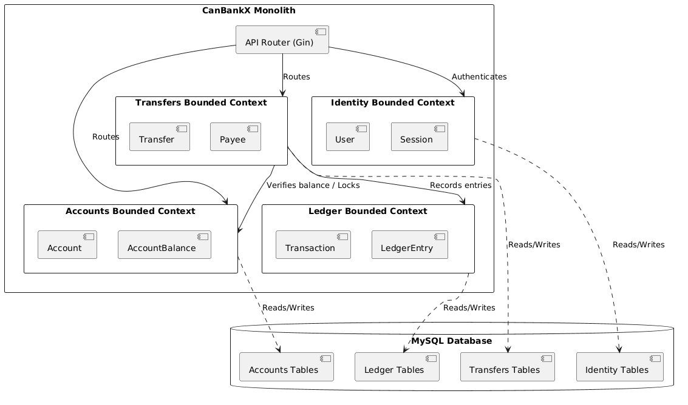
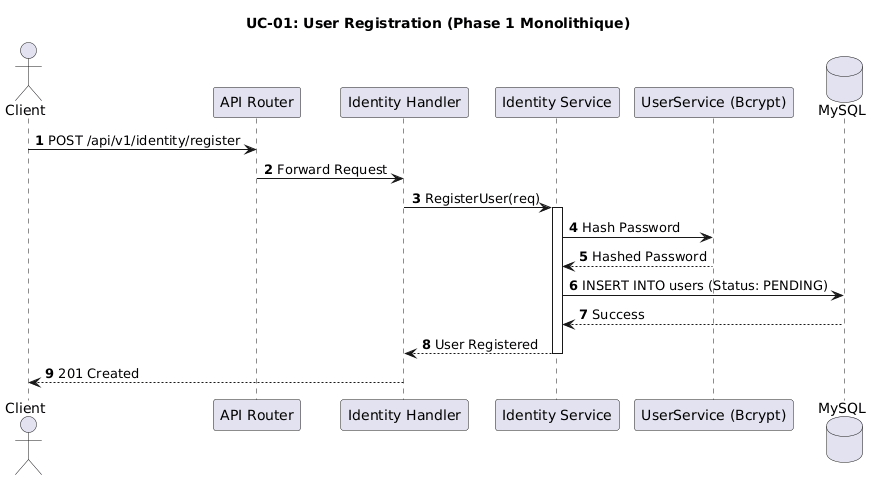
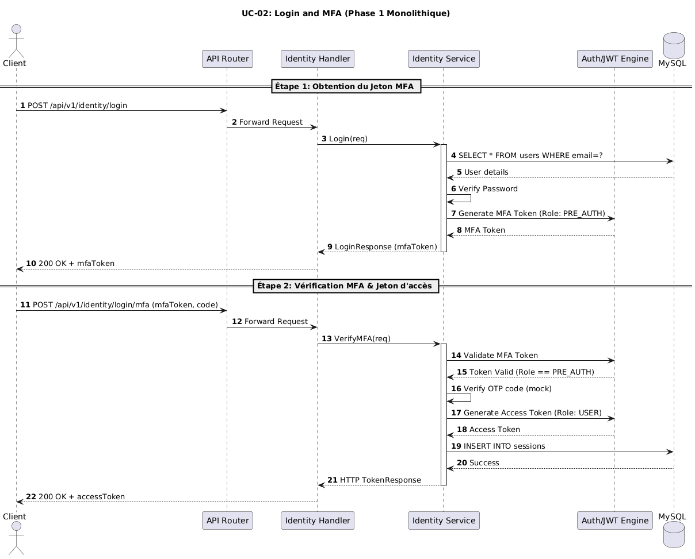
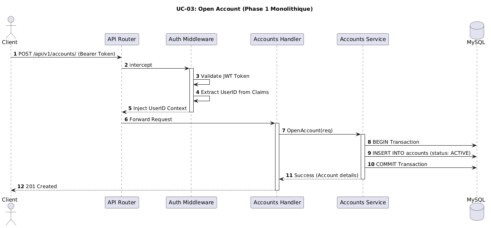
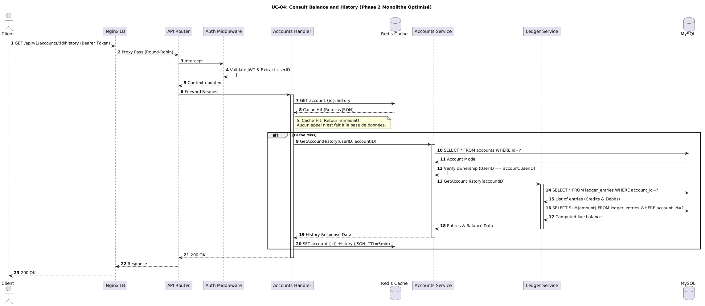
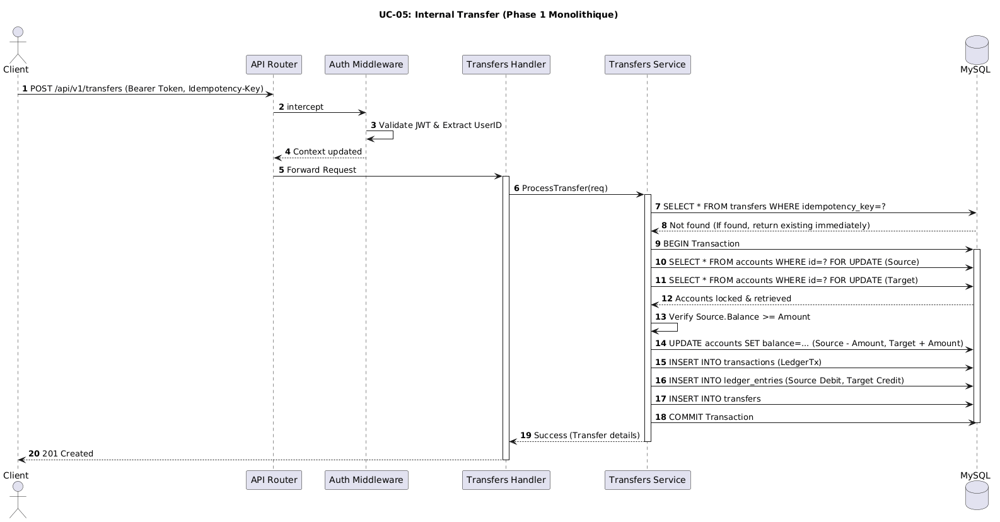
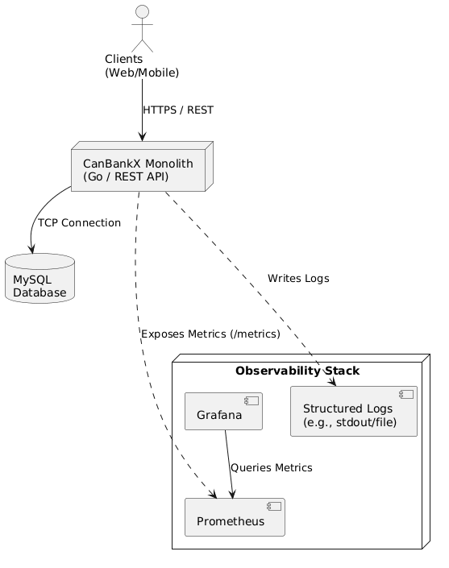
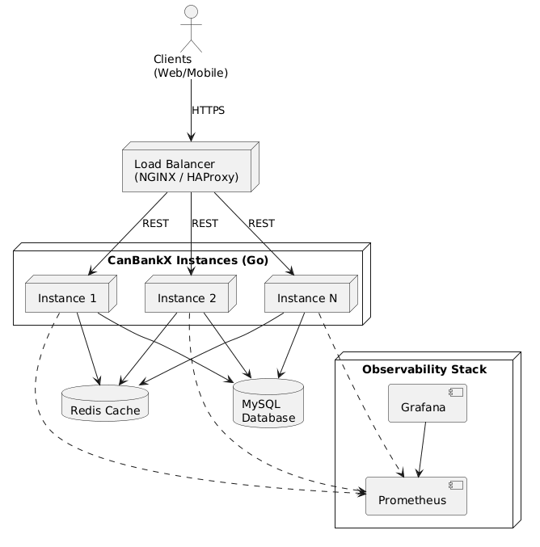
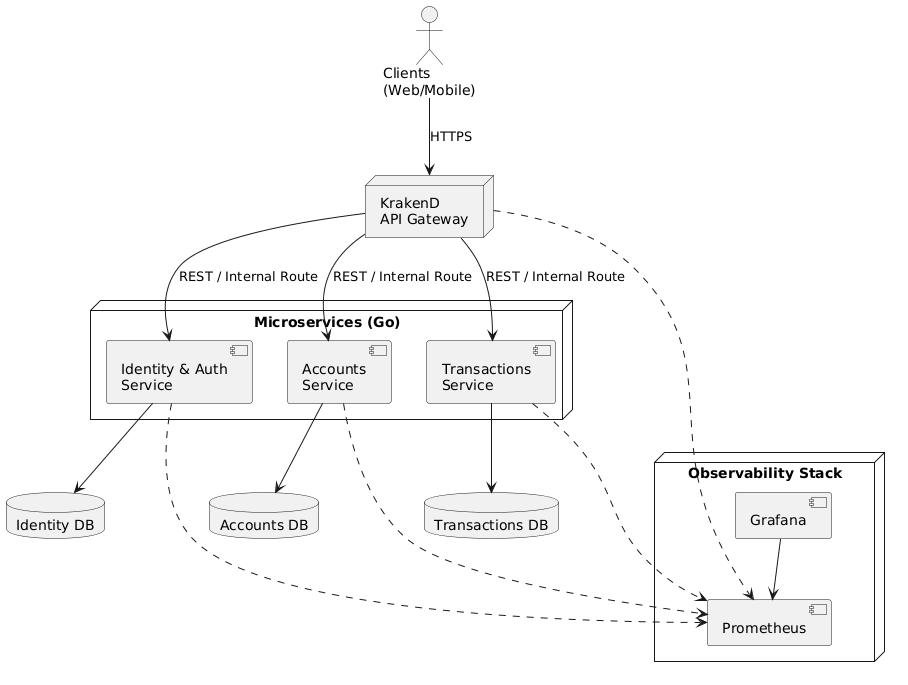

# Vues 4+1 (Modèle de Kruchten) - CanBankX

Le modèle 4+1 décrit l'architecture selon cinq perspectives distinctes pour répondre aux besoins de différents intervenants.

---

## 1. Vue Logique (Logical View)
La solution a évolué vers une **Architecture Microservices Répartie**. Chaque domaine métier possède son propre conteneur applicatif et sa propre base de données.

- **Module Identity :** `User`, `Role`, `Session`, `KYCDocument`.
- **Module Accounts :** `Account`, `AccountBalance`. Lit et écrit au travers de **Redis** pour l'historique et les soldes afin de gérer les charges massives.
- **Module Transfers :** `Transfer`, `Payee`.
- **Module Ledger :** `LedgerEntry`, `Transaction`.

Ces modules (services) communiquent désormais via des requêtes HTTP synchrones REST (`/internal/v1/...`) sans partager directement leurs modèles de base de données.

---

## 2. Vue Processus (Process View)

L'application a été découpée en 5 scénarios critiques (Cas d'utilisation), chacun disposant de son propre diagramme de flux :

### UC-01 : Création d'Utilisateur

### UC-02 : Login & MFA

### UC-03 : Ouverture de compte (Accounts)

### UC-04 : Consultation du solde et historique (Ledger) avec Cache

*Cette consultation sollicite d'abord Redis pour une réponse quasi-instantanée, permettant d'épargner de lourds `SELECT` à MySQL.*

### UC-05 : Virement de fonds (Transfers)

**Principale complexité (Virement) :**
1. Requête HTTP entrante.
2. L'API Gateway **KrakenD** achemine la requête et transmet le JWT.
3. Le **Contrôleur (Transactions Handler)** vérifie l'`Idempotency-Key` et valide le JWT via le middleware.
4. Si la clé est nouvelle, le service *Transactions* orchestre :
   - Requête HTTP interne vers le service *Accounts* (`POST /internal/v1/accounts/transfer`).
   - Le service *Accounts* applique un verrouillage pessimiste sur les comptes et ajuste les soldes.
   - Si Accounts valide, le service *Transactions* effectue l'écriture locale d'une `Transaction` et de deux `LedgerEntry` dans la base `transactions_db`.
5. Si tous les appels sont réussis, retour HTTP `201 Created` / `200 OK` via la passerelle.

*Note : Sous charge (k6), la base de données MySQL applique des verrous de lignes (`FOR UPDATE`) sérialisant l'accès au même compte, affectant potentiellement le RPS sur les comptes "hot spot".*

---

## 3. Vue Développement (Development/Implementation View)

## 4. Vue Déploiement (Physical/Deployment View)
*Dédiée aux administrateurs systèmes et ingénieurs DevOps (Phase 1 Baseline).*

**Archive (Phase 1 - Monolithe de base) :**

- Node 1: Serveur applicatif exécutant le binaire Go (Monolithe).
- Node 2: Base de données MySQL.

**Archive (Phase 2 - Monolithe Optimisé / Redis & LB) :**

- **Load Balancer :** Nginx exposant l'application en limitant l'accès direct.
- **App Nodes :** 3 instances (replicas) de conteneurs Docker exécutant l'application Go pour gérer le trafic.
- **Cache Node :** Redis assurant la mise en cache (Read-Through) et l'invalidation synchronisée des historiques de comptes.
- **Monitoring :** Prometheus / Grafana scrutant le `/metrics` des instances.

**Actuellement (Phase 3 - Architecture Microservices & API Gateway) :**

- **API Gateway :** KrakenD routant les demandes.
- **Services :** Microservices backend Go.
- **Bases de données :** Une base de données isolée par service.

---

## +1. Vue Scénarios (Use Cases View)

**Scénario de preuve (Virement) :**
Le client s'authentifie via le Identity-API, obtient un JWT, puis la Gateway route l'appel vers `POST /api/v1/transfers/`.
Le service Transactions valide le JWT (Vue Logique), exécute la logique de blocage distribué partielle (Vue Processus), interagit avec le service *Accounts* par réseau HTTP interne (Vue Développement), et stocke les données dans ses propres conteneurs MySQL distribués (Vue Déploiement).
